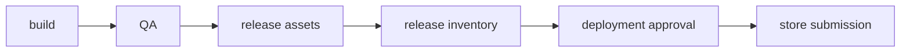

# Release

릴리스 후보와 배포 체크리스트를 관리한다.

- [2026-11-15 Android 아이콘 릴리스 v2.2.12(54)](2026-11-15-android-icon-release.md): Android 최소 검수·공개 전 검사와 제출81 이력 보존. 버전54 데이터 보안 선언 API 저장·웹 방침 공개 완료. Google이 Console 재심사 전송을 요구해 로그인 완료 대기 중.

## Gate

Deployment approval 전에는 production 제출/승격을 하지 않는다.

