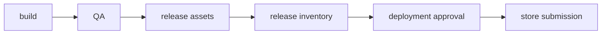

# Release

릴리스 후보와 배포 체크리스트를 관리한다.

- [2026-11-15 Android 아이콘 릴리스 v2.2.12(54)](2026-11-15-android-icon-release.md): Play 내부 테스트 완료, 공개 승격 전 Android 실행 검수 승인 대기.

## Gate

Deployment approval 전에는 production 제출/승격을 하지 않는다.

